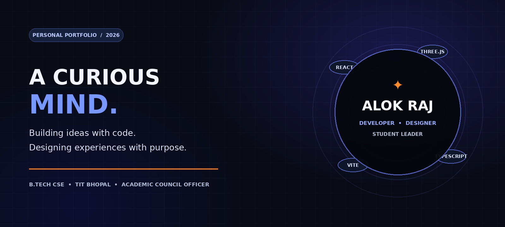
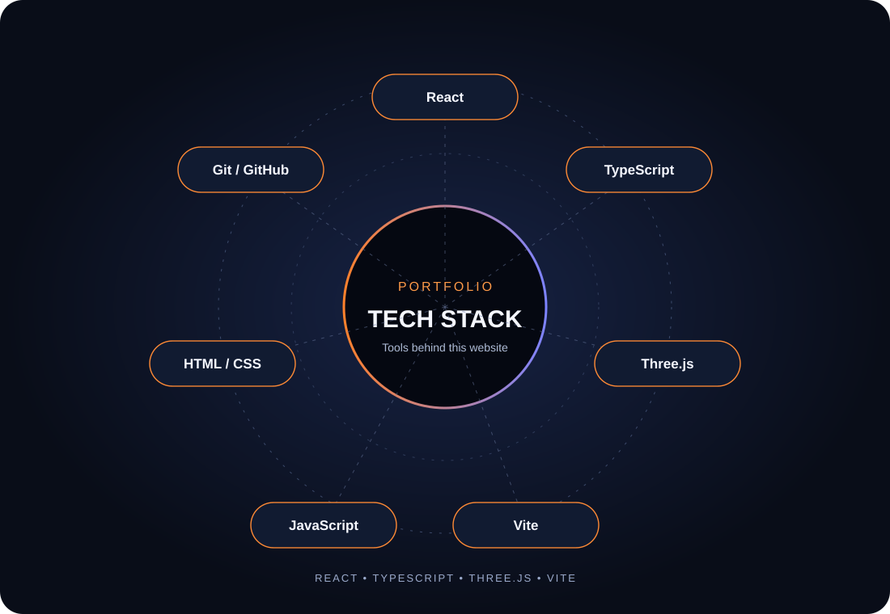

<div align="center">

# ✦ ALOK RAJ
### Developer · UI/UX Designer · Student Leader

<p>
  
</p>

<a href="https://alok-portfolio-silk.vercel.app/">
  
</a>
<a href="https://github.com/AlokRaj03">
  
</a>

<br/><br/>

<a href="https://alok-portfolio-silk.vercel.app/">
  
</a>

**A journey of curiosity, creativity, technology and leadership.**

[Visit Live Portfolio ↗](https://alok-portfolio-silk.vercel.app/)

</div>

---

## 🌌 My Digital Space

I'm **Alok Raj**, a B.Tech Computer Science & Engineering student at **Technocrats Institute of Technology (TIT), Bhopal**.

I enjoy the space where technology meets creativity — building web experiences, shaping user interfaces, designing posters and visual content, and collaborating with people to turn ideas into reality.

Alongside my technical journey, I serve as **Academic Council Officer, Student Council TIT**, contributing to student initiatives, orientation activities, coordination and campus experiences.

```javascript
const alok = {
  name: "Alok Raj",
  education: "B.Tech CSE — TIT Bhopal",
  roles: [
    "Developer",
    "UI/UX Designer",
    "Canva Designer",
    "Student Leader"
  ],
  interests: [
    "Full-Stack Development",
    "Java & Data Structures",
    "Artificial Intelligence",
    "UI/UX Design",
    "Software Engineering"
  ],
  mindset: "Learn. Build. Improve. Repeat."
};
```

---

## ⚡ Technologies Behind This Portfolio

<div align="center">


*Languages · Frameworks · Libraries · Tools*



</div>

### Portfolio website stack

| Area | Technologies |
|---|---|
| UI library | React 18 |
| Languages | TypeScript, JavaScript |
| 3D / Web graphics | Three.js |
| Markup & styling | HTML5, CSS3 |
| Build tool | Vite 6 |
| Package management | npm |
| Version control | Git, GitHub |
| Deployment | Vercel |

### Other tools & technologies I use or explore

`Java` · `C++` · `Node.js` · `Figma` · `Canva` · `VS Code` · `Data Structures & Algorithms`

> The animated ticker is a GIF rather than an HTML `<marquee>` because GitHub sanitizes some embedded HTML and does not reliably run marquee animations in README files.

---

## 🧭 My Journey

<p align="center"><i>Every milestone has a story. Every experience builds something new.</i></p>

<div align="center">
  
</div>

### 2024 — The Beginning
- Started my **B.Tech in Computer Science & Engineering** at TIT Bhopal.
- Began exploring programming and computer science fundamentals.
- Developed an interest in web development and technology.
- Started experimenting with creative digital designs.

### 2025 — Learning & Leadership
- Joined **Student Council, TIT Bhopal**.
- Became **Assistant Secretary of the Cyber Cop Cell**.
- Explored frontend development and programming languages.
- Started building personal projects and improving UI/UX design skills.
- Developed an interest in teamwork, collaboration and student activities.

### 2026 — Growth & Responsibility
- Took responsibility as **Academic Council Officer, Student Council TIT**.
- Led the student orientation process at TIT Bhopal.
- Earned **NPTEL certifications**.
- Contributed to the Student Council's digital presence and website development.
- Worked on workshop planning and student engagement activities.
- Contributed to planning **SKYVEX '26 — National Startup Hackathon**.
- Continued exploring Full-Stack Development, AI and modern web technologies.

### NEXT — The Journey Continues
- Strengthen Full-Stack Development, Java and DSA.
- Explore AI, emerging technologies and software engineering.
- Contribute to open-source communities.
- Build useful products and meaningful digital experiences.
- Keep learning, experimenting and creating.

<div align="center">

**STILL LEARNING. STILL BUILDING. ALWAYS EVOLVING. ✦**

</div>

---

## 🚀 Selected Projects & Builds

<div align="center">
  
</div>

| Project | Description | Technologies |
|---|---|---|
| **Personal Portfolio** | My digital identity, journey and project showcase. | React · TypeScript · Three.js |
| **Dusty Player** | A web music-player project focused on local music playback. | HTML · CSS · JavaScript |
| **Meet-Up** | A meeting and collaboration app concept. | React · Node.js |
| **Student Council Website** | Website and digital presence for Student Council activities. | Web technologies |

*Add repository and live-demo links to individual projects when they are public and ready to share.*

---

## 🎨 Design & Creativity

I believe development is not only about writing code. It is also about how people experience what we build.

- UI/UX design, layout and visual hierarchy.
- Poster, social media and presentation design.
- Canva and Figma creative workflows.
- Typography, color systems and responsive interfaces.
- Motion, interaction and digital storytelling.

---

## 🏛️ Leadership & Campus Contributions

**Academic Council Officer — Student Council, TIT Bhopal**

- Student orientation and coordination.
- Student Council website and digital presence.
- Club activities and student engagement.
- Workshop and event planning.
- Collaboration across student teams.

---

## 🤝 Let's Connect

<div align="center">

<a href="https://www.linkedin.com/in/alok-raj1">
  
</a>
<a href="https://www.codechef.com/users/alok_1012">
  
</a>
<a href="https://x.com/AlokRaj93880">
  
</a>
<a href="https://alok-portfolio-silk.vercel.app/">
  
</a>

</div>

---

<div align="center">

**Designed & developed by Alok Raj**

*Turning curiosity into creativity, and ideas into reality.*


</div>
